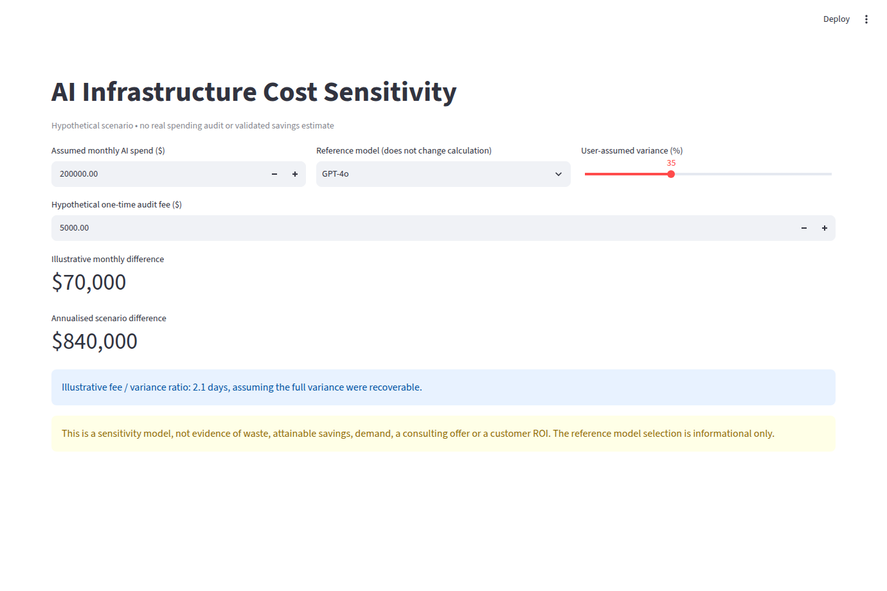

# AI Infrastructure Cost Sensitivity Calculator

A small open-source Streamlit app for **hypothetical AI-spend scenarios**, not cloud billing audits or verified savings forecasts.



*Example inputs only. Screenshot is automated browser evidence, not a validated customer outcome.*

## Zero-install offline app (recommended for customers)

**[Download the standalone HTML file](web/index.html)** from the repository (use GitHub's Raw or Download raw file option), then open it in a modern browser. All styling and calculations are embedded in that one file. No Python, npm, terminal, internet connection after download, or ZIP extraction is needed. It matches the existing `calculator.py` formulas and clearly labels every number as hypothetical.

Tests: `node --test tests/offline_web.test.mjs`. The original Streamlit application remains available below for developers.

## Streamlit development setup


Requires Python 3.10+.

```sh
git clone https://github.com/damunozx123-debug/ai-certainty-calculator.git
cd ai-certainty-calculator
python3 -m venv .venv
. .venv/bin/activate
python -m pip install streamlit
streamlit run app.py
```

Windows PowerShell: `py -m venv .venv`, `.venv\Scripts\Activate.ps1`, then `py -m streamlit run app.py`.

## What the numbers mean

Choose a hypothetical monthly infrastructure spend, a user-assumed variance percentage and an assumed one-off audit fee.

| Output | Formula |
|---|---|
| Illustrative monthly difference | spend × percentage / 100 |
| Annualised scenario difference | monthly difference × 12 |
| Hypothetical payback days | audit fee / monthly difference × 30, when monthly difference > 0 |

The reference model selector has **no influence** on calculations. This app does **not** connect to provider billing, assess real waste, price an audit, book appointments, estimate recoverable savings or prove demand. No externally validated cost model is supplied.

## Validation

```sh
python -m pip install pytest
python -m pytest -q
```

[CI verifies tests and captures the real Streamlit UI](.github/workflows/verify.yml).

## Guides

- [Install and limitations](docs/INSTALL.md)
- [Screenshot evidence rules](docs/SCREENSHOTS.md)
- [MIT licence](LICENSE)

Maintained by [Daniel Munoz](https://github.com/damunozx123-debug).
